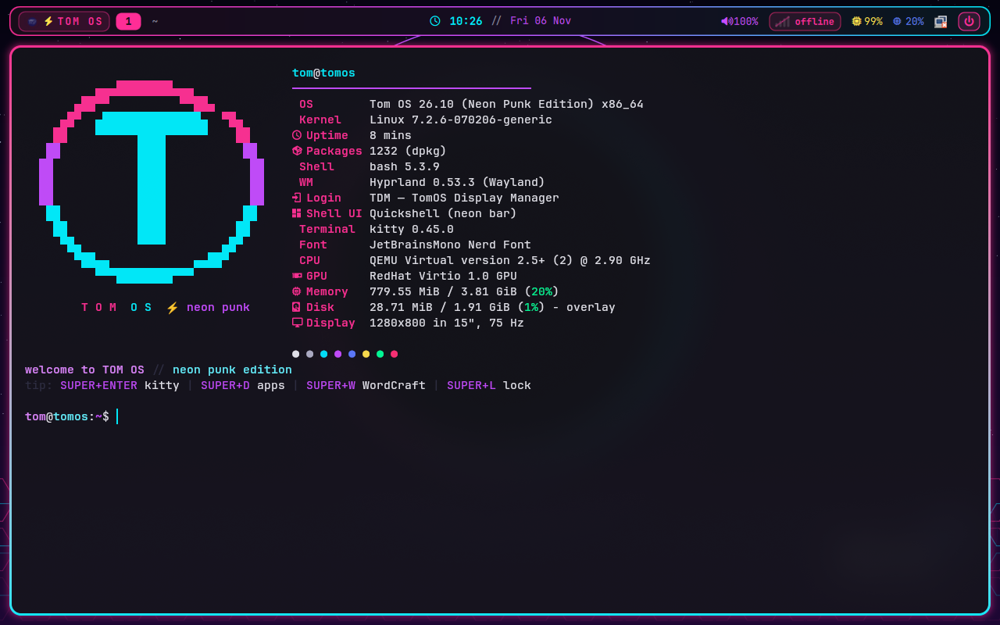
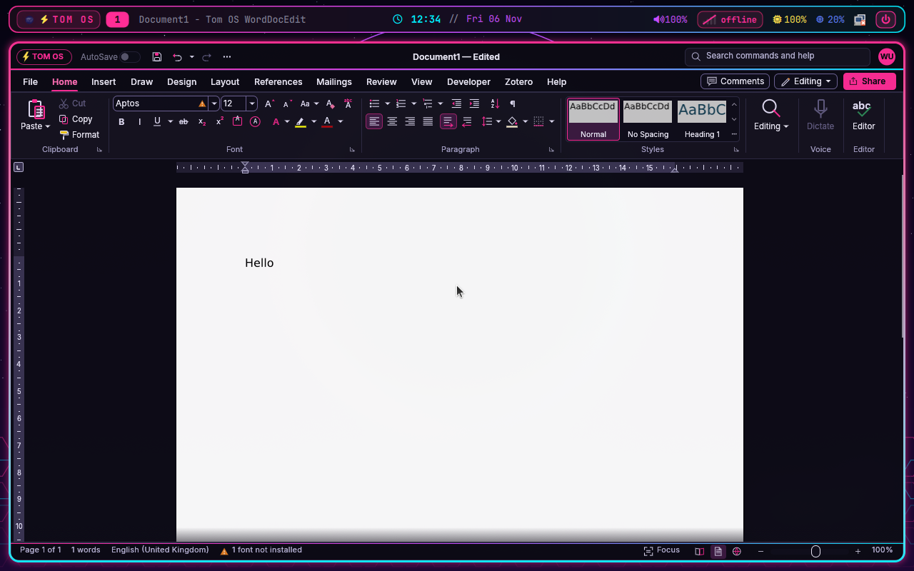
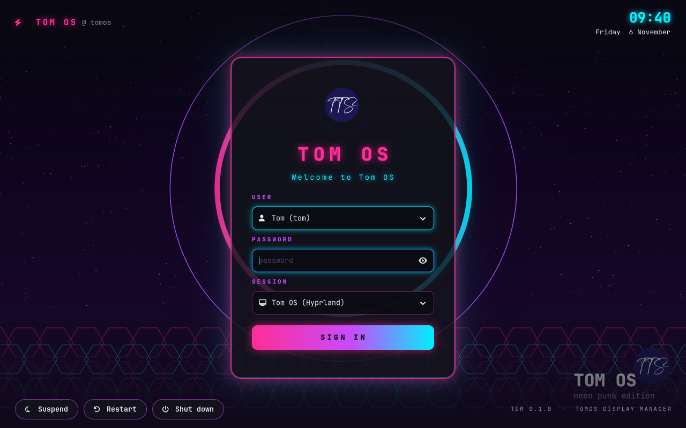
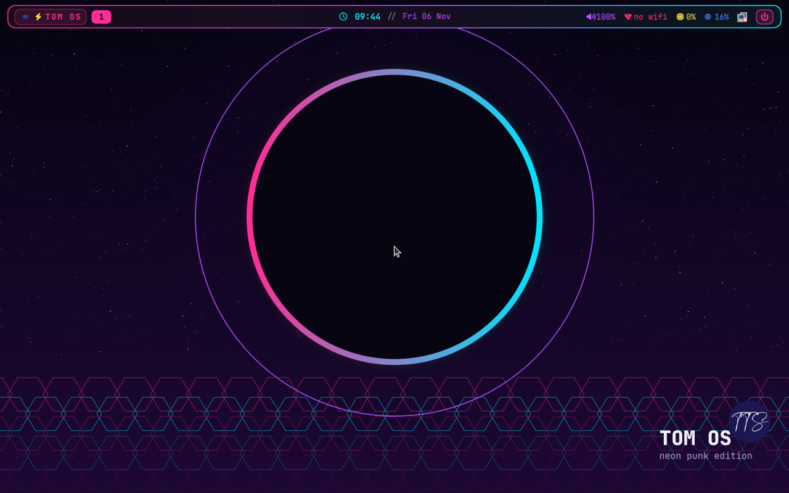
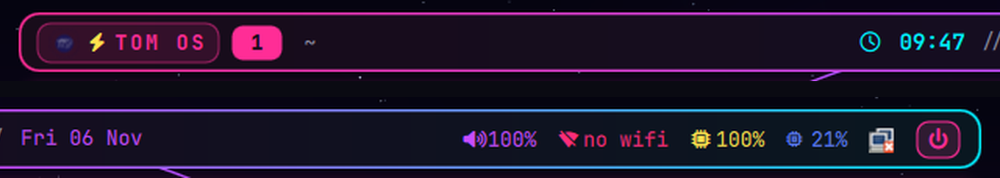
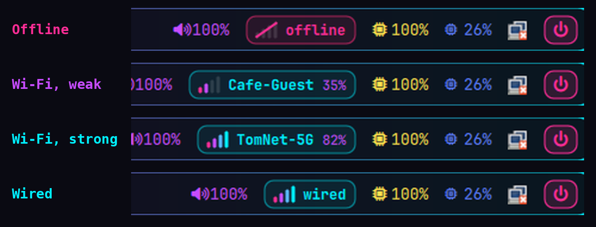

# ████ Tom OS 26.10 — Hyprland neon punk edition ████

Tom OS is a lightweight, Ubuntu-based live Linux distribution with a neon-punk
look. It boots from USB, runs Hyprland with a Tom OS-branded Quickshell bar,
logs in through its own TDM display manager, and can install itself to disk
with Calamares.





## Download the ISO

The ISO (2.6 GB) is in the [`download/`](download) folder, stored with Git LFS.
GitHub limits single files to 2 GB, so it is split into three parts. Open each
part on GitHub and press **Download raw file**, or clone with Git LFS
(`git lfs install && git clone https://github.com/Spruhantom/tom-os-hyperland1`).
Then join the parts:

**Linux / macOS**
```bash
cd download
cat tomos-26.10-amd64.iso.part1 tomos-26.10-amd64.iso.part2 tomos-26.10-amd64.iso.part3 > tomos-26.10-amd64.iso
sha256sum -c tomos-26.10-amd64.iso.sha256
```

**Windows (Command Prompt)**
```bat
copy /b tomos-26.10-amd64.iso.part1 + tomos-26.10-amd64.iso.part2 + tomos-26.10-amd64.iso.part3 tomos-26.10-amd64.iso
certutil -hashfile tomos-26.10-amd64.iso SHA256
```

The SHA-256 of the full ISO is:
`51ce25324e256481823bc3a957e3d74f06dc9c4bc6c16baea3e3c6ab97862b4f`

Then write it to a USB stick with Ventoy, Rufus, balenaEtcher or `dd`.
It boots in BIOS and UEFI mode (Secure Boot off).

## Documents

- [Welcome to Tom OS (PDF)](docs/TomOS-Welcome.pdf) — every perk, plus a first-five-minutes guide ([Markdown version](docs/TomOS-Welcome.md))
- [Keyboard Shortcuts (PDF)](docs/TomOS-Keyboard-Shortcuts.pdf) — every keybind, bar control and login-screen key

## Screenshots

| Login screen (TDM) | Desktop (Quickshell) |
|---|---|
|  |  |

| Quickshell bar | Network badge states |
|---|---|
|  |  |

A lightweight, Ubuntu-based live OS with a neon-punk design — built for Tom.

- **Base:** Ubuntu 26.04 LTS (resolute), mainline-stable **Linux kernel 7.2.6** (with headers) + the latest upstream firmware (linux-firmware 20261019)
- **Wallpaper:** “Neon Eclipse” default (4K, in /usr/share/backgrounds/tomos/) + the synthwave city alternative
- **Display manager:** TDM — TomOS Display Manager 0.1.0 (GTK4 neon greeter on greetd + cage, see `tdm/README.md`); ly kept as a fallback (`tomos-dm ly`)
- **Desktop shell:** Quickshell neon bar + wallpaper (default) — SUPER+SHIFT+B switches to Waybar
- **Window manager:** Hyprland 0.53.3 (Wayland)
- **Terminal:** kitty with a custom neon palette; fastfetch with a Tom OS logo runs when kitty opens
- **Word processor:** [Tom OS WordDocEdit](https://github.com/Spruhantom/tomos-worddocedit) 0.15.1 — the neon-themed Tom OS edition of WordCraft (.docx, .odt, .rtf, Markdown, PDF export) — SUPER+W
- **SIP softphone:** optional Zoiper 5 (proprietary; not redistributed with Tom OS). To enable SUPER+Z, download the Linux Debian package from [Zoiper's official download page](https://www.zoiper.com/en/voip-softphone/download/current) and place the `.deb` in `build/config/includes.chroot/root/tomos-debs/` before building.
- **Apps:** Nautilus, GNOME Text Editor, GNOME Web (GTK3 + GTK4 themed), Waybar, wofi, mako, pavucontrol
- **Installer:** Calamares 3.3.14 — "Install Tom OS" in the app launcher
- **GTK3 + GTK4:** custom "TomOS" neon theme; libadwaita apps get dark + magenta accent via dconf

## Live session login

| | |
|---|---|
| username | `tom` |
| password | `live` |

Keyboard layout is GB, locale `en_GB.UTF-8`, timezone Europe/London. A neon
"welcome to TOM OS" message greets you in every terminal (with fastfetch in kitty;
set `TOMOS_NO_FASTFETCH=1` to skip it). The TDM login screen shows Suspend /
Restart / Shut down buttons.

## Building the ISO

Requirements: about 14 GB free disk space and an internet connection.

### One-line online build command (Omarchy / Arch)

To download the bootstrapper, install the required host tools, clone/update the
source, build Tom OS, and assemble the hybrid ISO, run:

```bash
curl -fsSL https://raw.githubusercontent.com/Spruhantom/tom-os-hyperland1/main/install-build.sh | bash
```

By default, the source is placed in `~/tom-os-hyperland1`. To choose another
folder, set `TOMOS_DIR` before running the command.

### On Omarchy / Arch Linux

The build script automatically detects Arch-based systems and runs the Ubuntu
26.04 `live-build` toolchain in an isolated Podman container. This keeps APT
and Debian build dependencies out of your Omarchy installation.

Install Podman and build:

```bash
sudo pacman -S podman
./build.sh
```

The first run builds the `tomos-ubuntu-builder:26.04` container image and
downloads the Ubuntu build dependencies. Later runs reuse the cached image.
The container is run with the privileges needed by `live-build`; the script
returns generated build files to your normal user.

Docker is also supported if you already have it installed.

### On Ubuntu / Debian

Install the native build dependencies and run the same script:

```bash
sudo apt-get update
sudo apt-get install live-build debootstrap squashfs-tools xorriso \
     grub-pc-bin grub-efi-amd64-bin grub-common mtools rsync curl git
./build.sh
```

The finished live-build output is in `build/`. To assemble the final hybrid
BIOS + UEFI ISO, run `./make-iso.sh`. On Omarchy, install its host-side tools
first with `sudo pacman -S grub xorriso mtools`; on Ubuntu/Debian they are
included in the package list above.

All dotfiles, themes, hooks and package lists are stored in `build/config/`.

## Flashing to USB

```bash
sudo dd if=build/tomos-live-amd64.iso of=/dev/sdX bs=4M status=progress conv=fsync
```

Or use Rufus / Ventoy / balenaEtcher on Windows. The ISO is hybrid, so it also
works in BIOS and UEFI mode (Secure Boot must be **off** — the image is not
signed with Microsoft's keys).

### Optional: persistent storage

After flashing, create an extra partition labelled `persistence` on the USB
stick, create `/persistence.conf` on it containing `/home - overlay` and boot
with `persistence` added to the kernel command line (press `e` in the GRUB
menu).

## Installing to disk

Launch "Install Tom OS" (SUPER+D → search, or the desktop entry). Calamares
unpacks the live system onto the disk, sets up GRUB, creates your user, and
enables TDM (greetd) + NetworkManager in the installed system. WordDocEdit, the kernel
7.2.6 + headers and all theming carry over.

## Key bindings

| Keys | Action |
|---|---|
| SUPER+ENTER | kitty |
| SUPER+D | app launcher (wofi) |
| SUPER+W | Tom OS WordDocEdit |
| SUPER+E | Nautilus |
| SUPER+B | GNOME Web |
| SUPER+Q | close window |
| SUPER+L | lock (hyprlock) |
| SUPER+F11 | fullscreen |
| SUPER+1..5 | workspaces |
| Print | screenshot |
| SUPER+SHIFT+B | switch bar: Quickshell ⇄ Waybar |
| Power button (bar) | lock / suspend / restart / shut down / log out |

## Layout

```
tomos/
├── build.sh              # wraps lb build
├── assets/               # wallpaper, logo (generated by gen_*.py)
├── sources/              # ly source, kernel debs, fonts
└── build/config/
    ├── package-lists/     # Tom OS manifest
    ├── includes.chroot/  # dotfiles, themes, ly, calamares, session
    └── hooks/live/       # firmware overlay + finalize hooks
```

## Notes

- **Quickshell** draws both the bar and the wallpaper, so it works on any GPU
  (including VMs with software rendering). To change the wallpaper, put a file
  name or path in `~/.config/tomos/wallpaper` (e.g. `wallpaper.png`). In
  Waybar mode, hyprpaper draws the wallpaper instead.
- The network badge on the Quickshell bar shows four neon signal bars
  (pink → cyan) lit by Wi-Fi strength, "wired" for Ethernet and a pulsing
  pink slash when offline. Click it for network settings.

- libadwaita apps (Nautilus, GNOME Text Editor, GNOME Web) don't load custom
  GTK themes by design; they get the neon treatment via dark mode + magenta
  accent colour. Native GTK3/GTK4 apps use the full TomOS theme.
- The kernel is the latest stable mainline build available from Ubuntu's
  kernel team (v7.2.6). Point releases newer than the build are folded in via
  the Ubuntu 7.0 stock kernel not being included — 7.2.6 is the sole kernel.
- Status: the v26.10 ISO was built and boot-tested in QEMU (UEFI): GRUB →
  TDM login → Hyprland with the Quickshell bar → kitty with fastfetch, and
  SUPER+W → Tom OS WordDocEdit (rebuilt 6 Nov 2026).

## Third-party packages not stored in git

`build/config/includes.chroot/root/tomos-debs/` already holds the small helper
packages (greetd, cage, wlroots 0.19, Quickshell…) and
`tomos-worddocedit_0.15.1+tomos1-1_amd64.deb` (built from
[tomos-worddocedit](https://github.com/Spruhantom/tomos-worddocedit); it replaces
the `wordcraft` package). Add these large ones
before building (too big for git, or not redistributable):

- `linux-image-unsigned-7.2.6-070206-generic_*_amd64.deb`, `linux-modules-7.2.6-070206-generic_*_amd64.deb`, `linux-headers-7.2.6-070206_*_all.deb` (+ the generic headers) — from the [Ubuntu mainline kernel archive](https://kernel.ubuntu.com/mainline/v7.2.6/)
- `zoiper5_5.6.15_amd64.deb` — Zoiper 5 free, from [zoiper.com](https://www.zoiper.com/en/voip-softphone/download/current)

After `lb build` has produced the chroot, `sudo ./make-iso.sh` repacks the
squashfs and writes the hybrid BIOS/UEFI ISO `tomos-26.10-amd64.iso`.
